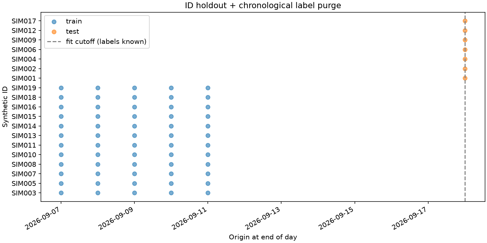
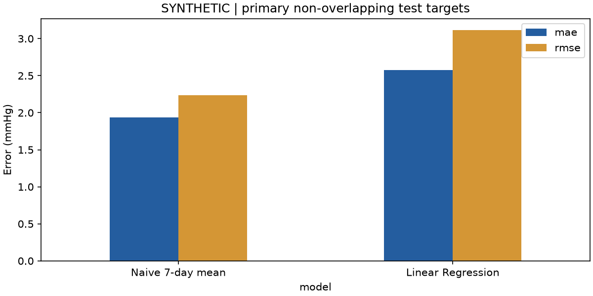
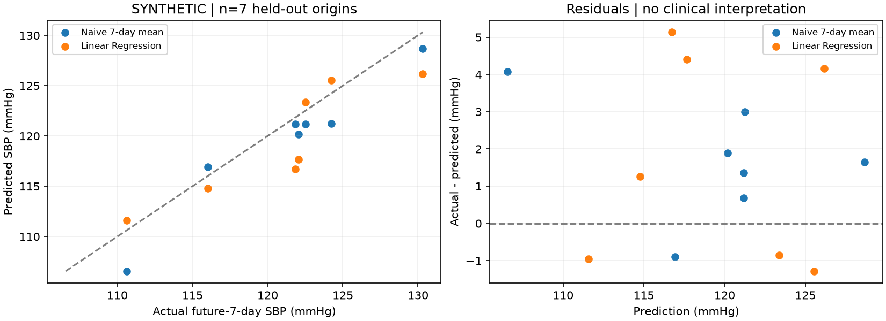

# CP3 Baseline Report - DATA SINTETIS / SIMULASI

Dihitung oleh `etl/verify_baseline.py`, bukan pengisian metrik manual. Run `5d3bed0d6591cd2bc09d`. Target `future_7d_mean_sbp` **belum disetujui final oleh dosen**. Tidak ada validitas klinis, diagnosis hipertensi, atau hasil penelitian aktual.

## Definisi, fitur dan persyaratan

Origin adalah **akhir hari t**, setelah pengukuran/perilaku t tersedia. SBP sesi = rerata pembacaan SBP diterima parser; SBP harian = rerata sesi yang lolos gate teknis pasangan pembacaan (Pagi/Malam berbobot sama bila keduanya tersedia). Target = rerata tujuh SBP harian **t+1..t+7**, bukan rerata semua sesi dengan bobot hari berbeda. Histori **t-6..t** dan target masing-masing wajib tujuh tanggal berurutan dengan SBP harian tersedia. Window tidak lengkap dilewati; tidak membuat hari palsu. Satu pasangan lengkap pada nomor pembacaan sama dapat dipakai bila tidak ada komponen ambigu. Pasangan silang, komponen parsial dan SBP<=DBP menunggu review dan tidak masuk agregat/model. Ini gate teknis sementara, bukan keputusan klinis; aturan penelitian final harus disetujui dosen.

Fitur: `past_7d_sbp, past_7d_dbp, past_7d_sbp_std, age, bmi, past_7d_activity, past_7d_sleep, past_7d_stress`. Perilaku hanya dari histori, NA diabaikan pada rerata histori; median training mengisi fitur seluruh historinya kosong. Simpangan baku ddof=0. Profil usia/BMI diasumsikan diketahui sebelum origin pada fixture statis. Ketersediaan profil/late submission aktual belum dibuktikan; tidak mengklaim asumsi ini berlaku pada penelitian aktual.

## Audit leakage dan metode

19 ID sintetis, 570 ID-tanggal, 1140 sesi; 323 complete windows. Split ID GroupShuffleSplit: 32% ID holdout, seed 42. Skema lama: 204 train / 119 test pada kalender sama, 672 kelebihan ID-hari target test akibat window berurutan. Split lama memang memisahkan subjek dan preprocessing hanya fit train, tetapi belum evaluasi ramalan masa depan ketat.

Evaluasi utama memilih batas **sebelum melihat skor**, 60% kalender observasi = **2026-09-18**. Train `target_end <= cutoff`; test ID terpisah dan `asof_date >= cutoff`; target test per ID berjarak minimal tujuh hari. Hasil **60 train / 7 test**, 12 ID train / 7 ID test. Semua label train sudah diketahui saat origin test pertama.

Audit aktual: `{"subject_overlap": [], "shared_measurement_id_dates": 0, "train_target_end_max": "2026-09-18", "test_origin_min": "2026-09-18", "labels_available_before_test": true, "test_overlapping_target_id_days": 0, "imputer_matches_training_only": true, "scaler_matches_training_only": true, "training_overlapping_target_id_days": 288}`.

Training windows tetap overlap **di dalam train**, sehingga baris train tidak independen. Test utama tidak overlap per ID; tidak ada ID atau kunci pengukuran ID-tanggal dibagi antarsubset. Median imputer dan mean scaler diverifikasi terhadap train saja. Tidak ada tuning/pemilihan cutoff berdasarkan skor test. Jumlah sampel kecil dan satu split tidak membuktikan generalisasi.

## Metrik utama sebenarnya

| Metode | MAE (mmHg) | RMSE (mmHg) | R2 |
|---|---:|---:|---:|
| Naive 7-day mean | 1.933673 | 2.234723 | 0.850309 |
| Linear Regression | 2.575492 | 3.113985 | 0.709343 |

MAE lebih kecil pada sampel ini: **Naive 7-day mean**. MAE Linear - naive = **0.641818 mmHg**. Bukan uji signifikansi/model klinis terbaik. R2 bukan accuracy persen; bergantung variasi antar-ID dan hanya 7 origin. Tidak ada validation set/tuning atau klaim model final.

## Sensitivitas dan analisis error

Skor subject-only dan purged rolling ada di `experiment.json`; prediksi lengkap di `legacy_predictions.csv` / `rolling_predictions.csv`. Purged rolling memiliki 42 baris test namun target saling overlap, sehingga hanya sensitivitas. Skor beda split tidak membuktikan peningkatan model.

Error absolut Linear terbesar: **SIM009, origin 2026-09-18**, aktual 121.857143, prediksi 116.720810, residual 5.136333 mmHg. Dugaan yang perlu diperiksa: perubahan masa depan tidak tertangkap histori, perbedaan antar-ID holdout, dan train kecil; bukan penyebab terbukti. `error_analysis.csv` mengurutkan seluruh error; `primary_predictions.csv` mempertahankan presisi untuk verifikasi ulang.

DATA SINTETIS; hanya 7 origin uji pada 7 ID. Target belum disetujui. Training windows masih berkorelasi; profil statis diasumsikan diketahui sebelum origin. Bukan validasi klinis atau diagnosis.

## Reproduksi, artefak dan kompatibilitas

Dari root: `python -m etl.verify_baseline`. Membaca dua CSV sintetis dan menulis `models/`, `reports/cp3_baseline/`, laporan ini; tidak membuka DB. Notebook utama `notebooks/03_verifikasi_baseline_cp3.ipynb`: `python -m etl.execute_cp3_notebook`. Notebook 01 merupakan catatan awal, bukan hasil final verifikasi ini.

Versi aktual: `{"python": "3.13.7", "numpy": "2.5.4", "pandas": "3.0.6", "sklearn": "1.9.1", "joblib": "1.6.0"}`. Hash sumber/dataset/kode ada pada provenance. `baseline_manifest.json` memasangkan metrics/model melalui hash; API menolak artefak hilang/rusak. Field lama JSON untuk dashboard dipertahankan dengan tambahan audit/config/run ID. Prediksi joblib hasil reload dibandingkan dengan CSV dalam tes.

Endpoint tetap naive, bukan inferensi Linear Regression, memakai fungsi agregasi yang sama dengan eksperimen dan melaporkan rentang histori/ramalan. Metrik evaluasi berasal dari artefak; kecocokan warehouse dilaporkan terpisah. Sumber non-sintetis tetap dibatasi.

