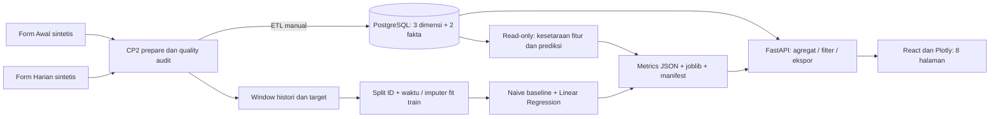

# CP3 Progress Report - Minggu 8

> **CATATAN SINKRONISASI (10 Nov 2026, CP3-K01):** Dokumen ini historis. Aturan sesi valid terbaru memakai gate pasangan pembacaan bersama (SBP/DBP bernomor sama) pada ETL, API, dan baseline sekaligus — lihat [`P0_P1_FINAL_AUDIT.md`](P0_P1_FINAL_AUDIT.md) untuk definisi final dan [`reports/p0_p1_final_verification.md`](../reports/p0_p1_final_verification.md) untuk bukti tes terbaru (10 Nov 2026).

**DATA SINTETIS / SIMULASI.** CP3 selesai secara teknis pada fixture; bukan persetujuan dosen, kecukupan data primer, validitas klinis atau deployment akhir. Hasil terbaru dirangkum pada [CP3_FINAL_REPORT.md](CP3_FINAL_REPORT.md).

## Acuan dan progres CP1-CP3

Brief `Deskripsi_Proyek_DA_DS.pdf` hal. 4-6 membedakan dashboard/visualisasi akhir dari timeline: M6 dashboard v1 dan feature engineering, M7 baseline+pembanding, M8 demo tengah dan laporan baseline/rencana eksperimen. Panduan utama hal. 10-12/16 menegaskan grain, missing bukan nol, label sintetis, keputusan terbuka dan timeline. Dokumen adalah acuan spesifikasi, bukan otorisasi mengubah target atau bukti persetujuan yang belum ada.

| Checkpoint | Implementasi/bukti tersedia | Status dan batas |
|---|---|---|
| CP1 - proposal | Judul kerja, konteks analitik/KPI, target sementara dan keputusan terbuka dalam README/panduan/checkpoint | SEBAGIAN: tidak ditemukan proposal final yang disahkan atau bukti persetujuan dosen. Jangan mengklaim CP1 formal sudah disetujui. |
| CP2 - data readiness | Dua CSV, dictionary 52 kolom, EDA 5 temuan/10 gambar, notebook 02, ETL, 3 dimensi/2 fakta, audit relasi/missing | SELESAI teknis pada sintetis; [CP2_DATA_READINESS.md](CP2_DATA_READINESS.md). Data aktual masih terpisah dan tidak diolah dalam pekerjaan ini. |
| CP3 Tahap 1 | API PostgreSQL dinamis, empty state, ETL manual, filter/ekspor konsisten, tanpa auto-seed/upload | SELESAI; [CP3_STAGE1.md](CP3_STAGE1.md). |
| CP3 Tahap 2 | 8 halaman, 4 KPI, 34 panel grafik termasuk pengulangan konteks, grain dan asosiasi dijelaskan, drill-down/cross-filter, browser desktop/mobile | SELESAI; [CP3_STAGE2.md](CP3_STAGE2.md). Empat keluarga advance konservatif, bukan klaim lima jenis final. |
| CP3 Tahap 3 | Target sama, audit leakage ID/waktu/overlap/preprocessing, dua pendekatan dihitung ulang, notebook 03 dan artefak ber-manifest | SELESAI teknis; [CP3_BASELINE_REPORT.md](CP3_BASELINE_REPORT.md). Test hanya 7 origin/7 ID sintetis. |
| CP3 Tahap 4 | Compose demo terpisah, load awal hanya DB demo, pemeriksaan API/SQL/ML, tes, screenshot, checklist dan naskah demo | SELESAI teknis; bukti `reports/cp3_final/`, URL demo lokal 8081. |

## Arsitektur dan implementasi

Grain: profil satu ID; perilaku satu ID-tanggal; BP satu ID-tanggal-sesi. Grafik gaya hidup memakai rerata harian dari sesi terfilter; variabel harian tidak digandakan. Prediksi naive memakai definisi baseline SBP tersedia yang sama dengan eksperimen, dan aturan tersebut dibedakan secara eksplisit dari syarat sesi analitik SBP+DBP valid.

Model pembanding dilatih offline pada hasil parser CP2. Verifikasi tambahan membentuk ulang seluruh 323 window dari warehouse demo dan mencocokkannya dengan CSV eksperimen, kemudian reload joblib untuk mencocokkan prediksi test. Jadi tidak sekadar mengasumsikan sumber model dan dashboard sejalan. Endpoint prediksi tetap naive; tidak menyebutnya inferensi model Linear Regression.

## Validasi dan kendala

Hasil tes terbaru, metrik dan jumlah data di [laporan final](CP3_FINAL_REPORT.md) dihasilkan dari JSON eksperimen dan bukti tes mesin. Suite meliputi SQLite terisolasi, PostgreSQL 16 khusus tes/Python Linux, React, build produksi, serta browser pada Nginx/FastAPI/PostgreSQL demo. Empty/error browser disimulasikan pada response jaringan; DB tidak dikosongkan. Notebook 03 benar-benar dieksekusi dan menyimpan grafik/output.

Kendala lingkungan Windows: proses kernel Jupyter/esbuild dan direktori temporary pytest memerlukan eksekusi di luar sandbox proses. Pengujian dijalankan ulang sampai lulus; kegagalan izin tersebut tidak dicatat sebagai tes lulus. Peringatan tersisa: ukuran bundle Plotly sekitar 4,91 MB (1,49 MB gzip), deprecation Starlette/httpx, dan ukuran test ML yang kecil. Tidak ada klaim uji usability formal atau audit keamanan lengkap.

## Data aktif dan langkah setelah demo

Warehouse aktif hanya diperiksa dengan transaksi READ ONLY dan fingerprint sebelum/sesudah; tidak dimuat ulang. Stack `toba-cp3-demo` mempunyai jaringan/database sendiri dan tidak memakai volume aktif. Artefak `models/` diperbarui secara eksplisit sesuai tugas Tahap 3; service lama yang bind-mount folder ini dapat membaca metrik baru walaupun kode servicenya tidak di-restart. Demo terverifikasi menggunakan pasangan backend/frontend baru pada 8081.

Prioritas sesudah CP3: kunci keputusan target/protokol/pengguna bersama dosen, lanjutkan akuisisi aktual dan audit izin/kualitas, baru rencanakan modelling/visualisasi lanjutan dan deployment. Rincian [CP3_NEXT_STEPS.md](CP3_NEXT_STEPS.md). Tidak dikerjakan pada finalisasi ini.
