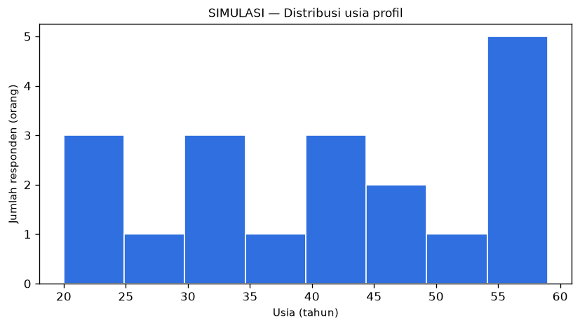
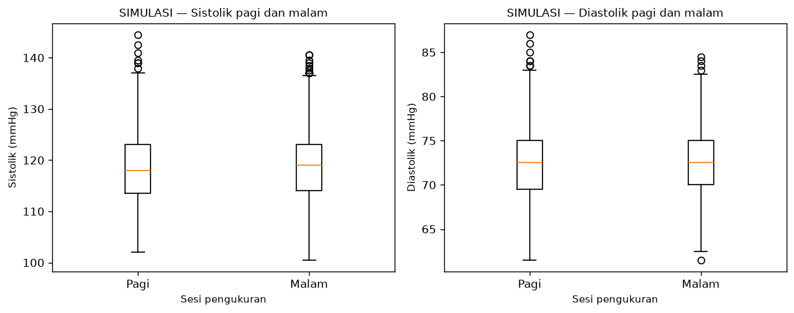
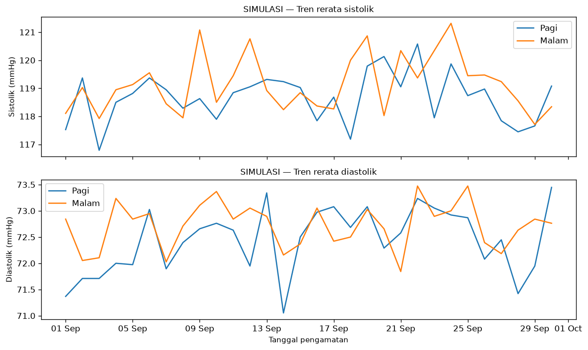
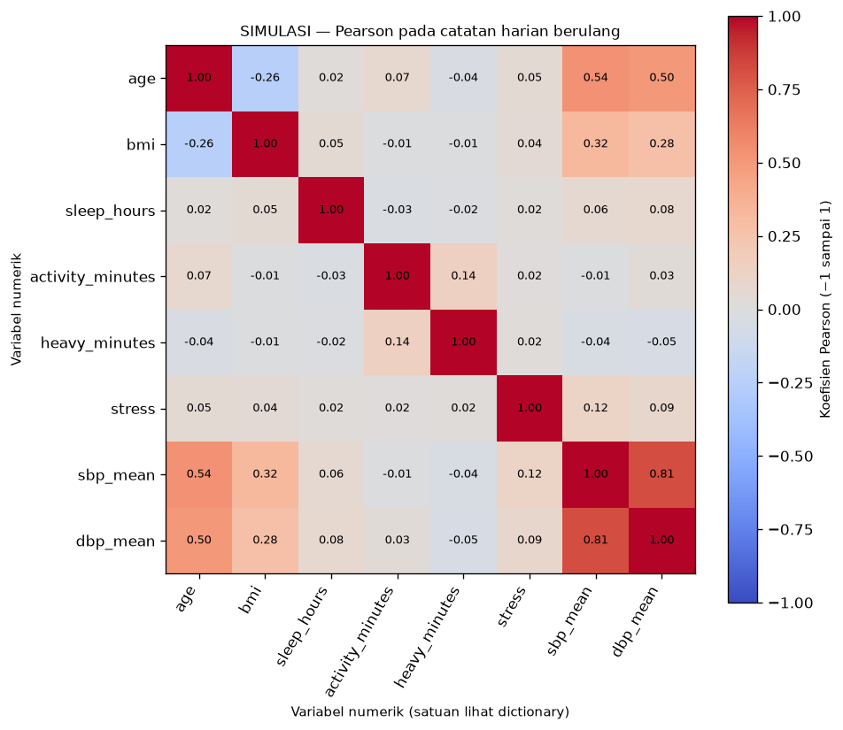
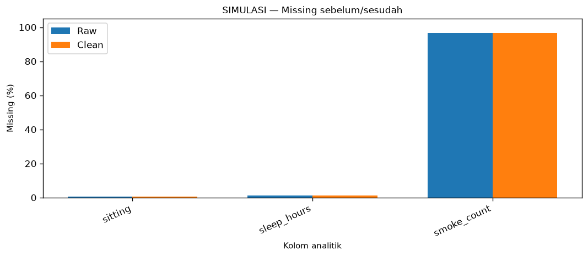

# Lima temuan EDA CP2 — SIMULASI

Seluruh angka dihitung dari hasil ETL dua CSV sintetis. Tidak digunakan untuk prevalensi, diagnosis, kesimpulan sebab-akibat atau klaim performa model. Lihat notebook `02_eda_data_readiness.ipynb` dan `reports/cp2/eda_summary.json`.

## 1. Cakupan profil dan variasi demografi

SIMULASI: 19 ID, 30 tanggal, 570 catatan harian dan 1140 sesi valid. Usia 20–59 tahun, rerata 41.42; 9 provinsi dan 16 kabupaten/kota. Jumlah catatan berulang tidak sama dengan jumlah orang.

## 2. Perbandingan pagi–malam berpasangan

SIMULASI: 570 pasangan ID-tanggal lengkap; rerata selisih Malam−Pagi 0.470 mmHg. Perbandingan memasangkan orang dan tanggal yang sama; ini statistik deskriptif, bukan efek kausal waktu.

## 3. Perubahan rerata harian selama periode simulasi

SIMULASI: rerata sistolik sesi pada 2026-09-01 adalah 117.816 mmHg dan pada 2026-09-30 118.711 mmHg (selisih +0.895 mmHg). Dua titik ini bukan bukti tren populasi atau perubahan klinis.

## 4. Hubungan gaya hidup pada grain harian

SIMULASI: korelasi Pearson aktivitas menit–SBP harian -0.012; tidur–SBP harian 0.059. Perhitungan satu baris per ID-tanggal, bukan menduplikasi perilaku ke dua sesi. Catatan dari orang yang sama saling berkaitan; tidak digunakan untuk uji kausal atau signifikansi populasi.

## 5. Missing tetap terlihat setelah cleaning

SIMULASI: tidur kosong 6/570 (1.053%), duduk kosong 3/570 (0.526%). Jumlah merokok NA 550/570; status merokok tidak dipakai untuk mengisi nol. 25 sesi diberi flag IQR; tidak ada sesi yang dihapus hanya karena flag statistik.

Denominator profil adalah orang; sesi adalah ID-tanggal-sesi; korelasi menggunakan catatan ID-tanggal. Korelasi pairwise mengabaikan NA per pasangan; tidak terdefinisi bila varians nol atau data tidak cukup. Sampel berulang tidak dianggap observasi independen. Tidak ada inferensi statistik atau training model pada CP2 ini.
