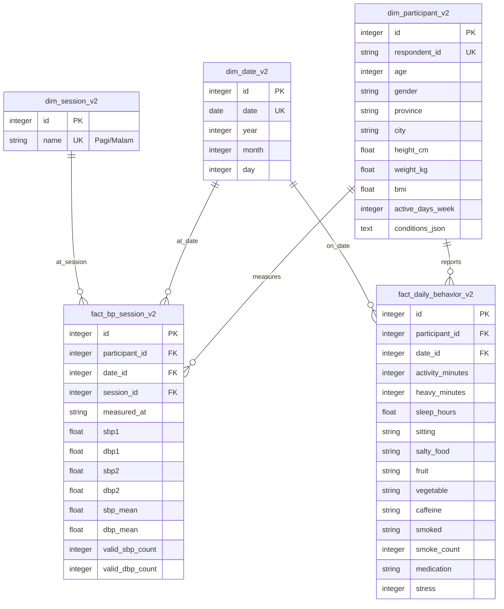

# ERD / model dimensional — CP2 Data Readiness

**Grain:** `fact_bp_session_v2`: satu orang × satu tanggal × satu sesi. `fact_daily_behavior_v2`: satu orang × satu tanggal. 3 dimensi: peserta, tanggal, sesi. Penyimpanan perilaku per hari mencegah penggandaan aktivitas dan tidur ketika satu hari memiliki dua sesi. Kolom `province/city` berasal dari formulir; tidak ada kecamatan fiktif.

Database v2 memakai nama tabel baru agar volume PostgreSQL lama dapat dipertahankan tanpa `DROP TABLE`. Ini versi checkpoint: migrasi produksi final dan kontrol akses masih diperlukan.

## Kunci, grain, dan metadata

| Tabel | PK | Natural key / keunikan | FK / relasi | Baris fixture |
| --- | --- | --- | --- | ---: |
| dim_participant_v2 | id | respondent_id (unique index) | Satu profil ke banyak sesi/harian | 19 |
| dim_date_v2 | id | date (unique index) | Satu tanggal ke banyak sesi/harian | 30 |
| dim_session_v2 | id | name (unique) | Satu jenis sesi ke banyak pengukuran | 2 |
| fact_bp_session_v2 | id | participant_id + date_id + session_id (unique constraint) | Tiga FK ke dimensi | 1140 |
| fact_daily_behavior_v2 | id | participant_id + date_id (unique constraint) | Dua FK ke dimensi | 570 |
| dataset_state_v2 | id (singleton 1) | Metadata batch, bukan dimensi tambahan | Sumber, jenis data, jumlah harian, quality_json | 1 |

Diagram menampilkan kolom utama; implementasi lengkap juga menyimpan pekerjaan, pendidikan, aktivitas umum dan konteks sebelum pengukuran. Tidak ada kolom nama/kontak di warehouse. `conditions_json` memuat sebelas jawaban riwayat, bukan identitas. FK non-null, sementara sel pengukuran/perilaku dapat null; validitas sesi dihitung dari jumlah pembacaan.

PK surrogate tidak harus tetap sama setelah reload. Idempotensi didefinisikan sebagai kesamaan natural key, nilai, jumlah baris, dan hash isi natural setelah input yang sama dimuat ulang. Warehouse audit memeriksa PK, FK, unique constraints **dan unique indexes**, orphan, serta hash tanpa nama.

`load_warehouse()` hanya mengganti tabel v2 dalam transaksi. Pada kegagalan, seluruh penggantian di-rollback. Tabel lama di luar daftar v2 tidak disentuh. Pemeriksaan CP2 yang mengubah isi dilakukan pada PostgreSQL sementara `toba_cp2_test`; database aktif diperiksa hanya melalui transaksi READ ONLY, tidak di-reload.

Jalankan `python -m etl.verify_warehouse` dengan `DATABASE_URL` yang sengaja dipilih untuk inspeksi SELECT-only. Tidak ada `create_all`, seed, atau commit pada perintah tersebut. Bukti eksekusi tersedia di `docs/CP2_DATA_READINESS.md` dan `reports/cp2/`.
