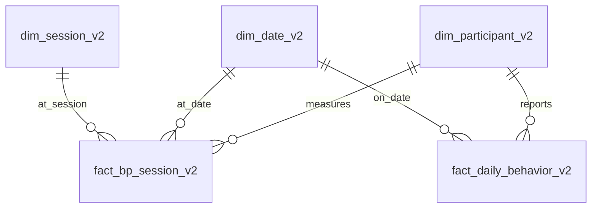

# ERD / model dimensional M6–M8

**Grain:** `fact_bp_session_v2`: satu orang × satu tanggal × satu sesi. `fact_daily_behavior_v2`: satu orang × satu tanggal. 3 dimensi: peserta, tanggal, sesi. Penyimpanan perilaku per hari mencegah penggandaan aktivitas dan tidur ketika satu hari memiliki dua sesi. Kolom `province/city` berasal dari formulir; tidak ada kecamatan fiktif.

Database v2 memakai nama tabel baru agar volume PostgreSQL lama dapat dipertahankan tanpa `DROP TABLE`. Ini versi checkpoint: migrasi produksi final dan kontrol akses masih diperlukan.
