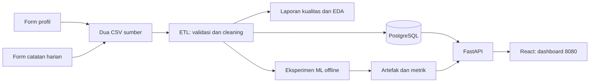
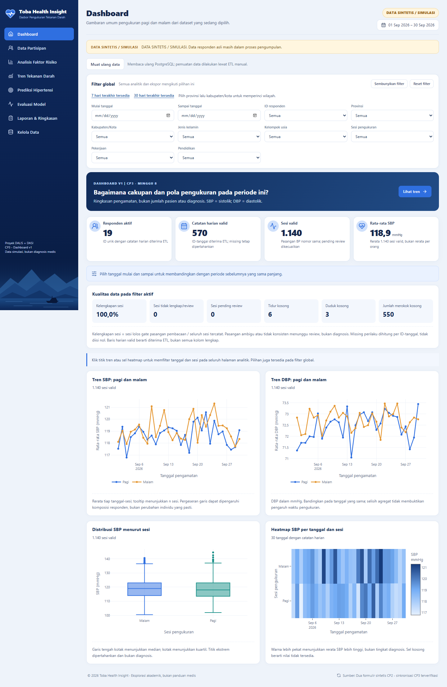
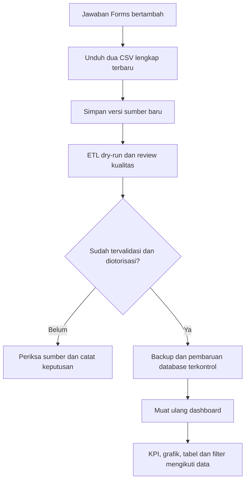

# Panduan visual cek progres CP3

**Toba Health Insight · DALIS–DASI · bahan penjelasan kelompok ke dosen**

Disusun **11 November 2026** berdasarkan kode dan bukti terakhir yang tersedia. Pengujian yang dirangkum dilakukan pada sesi konsolidasi **10 November 2026**; pembuatan panduan ini tidak menjalankan ulang tes atau mengubah aplikasi/database.

> **Pegangan utama:** prototipe CP3 sudah terintegrasi dan diuji pada **DATA SINTETIS / SIMULASI**. Pengumpulan data aktual dan keputusan metodologi masih perlu ditindaklanjuti. Hasil simulasi tidak dinyatakan sebagai hasil penelitian atau diagnosis.

## Peta baca cepat

| Ingin memahami… | Buka bagian |
| --- | --- |
| Apa yang harus disampaikan pertama kali | [1. Cerita singkat proyek](#1-cerita-singkat-proyek) |
| Arti angka dan alur data | [2. Angka](#2-angka-yang-harus-dipahami), [3. Alur](#3-alur-dari-formulir-sampai-dashboard) |
| Cleaning dan ketentuan proyek | [4. Proses data](#4-proses-data-sesuai-ketentuan-proyek) |
| Fungsi halaman dan filter | [5. Delapan halaman](#5-delapan-halaman-untuk-menjawab-apa), [6. Filter](#6-filter-sudah-mengikuti-dataset) |
| Upload, Kelola Data dan data bertambah | [7. Kelola Data](#7-kelola-data-bisa-apa), [8. Pembaruan dataset](#8-kalau-data-bertambah-bagaimana) |
| Apa yang sudah selesai dan belum | [10. Status](#10-status-sampai-demo-tengah-cp3) |
| Urutan demo dan latihan jawaban | [11. Demo](#11-alur-demo-5–7-menit), [12. Tanya jawab](#12-latihan-tanya-jawab-singkat) |

Legenda: **✅ tersedia dan diuji pada sintetis** · **🟡 sementara/perlu konfirmasi** · **⬜ belum tersedia atau belum dibuktikan**.

## 1. Cerita singkat proyek

**Tujuan sementara:** membantu membaca cakupan pencatatan dan pola pengukuran tekanan darah pagi/malam, mengeksplorasi asosiasi dengan kebiasaan harian, serta menguji baseline prediksi numerik.

Kalimat pembuka yang bisa disampaikan:

> “Pak/Bu, sampai CP3 kami sudah mengintegrasikan profil responden dan catatan harian melalui ETL ke PostgreSQL. Dashboard membaca database melalui API, dengan filter dan visualisasi dinamis. Kami juga sudah menguji baseline dan Linear Regression. Dataset yang ditampilkan masih sintetis untuk pengujian sistem; perkembangan data aktual kami laporkan terpisah.”

**Hal yang perlu kelompok sepakati:** siapa pengguna utama dashboard, pertanyaan keputusan apa yang dibantu, dan status persetujuan judul/tujuan. Jangan menyebut pengguna atau persetujuan sebagai fakta jika belum disepakati.

## 2. Angka yang harus dipahami

```text
                  19 RESPONDEN SINTETIS
                            ×
                      30 HARI
                            ↓
                 570 CATATAN ID–TANGGAL
                            ×
                  2 SESI: PAGI + MALAM
                            ↓
                    1.140 SESI BP
```

| Kartu dashboard pada fixture lengkap | Artinya | Jangan tertukar dengan |
| --- | --- | --- |
| **19 responden aktif** | ID unik dengan catatan harian diterima ETL pada filter | 570 orang |
| **570 catatan harian** | Satu baris mewakili satu ID pada satu tanggal | Jumlah sesi atau jumlah individu |
| **1.140 sesi valid** | Sesi pagi/malam yang lolos gate teknis pasangan BP | Jumlah responden |
| **118,9 mmHg rata-rata SBP** | Rerata SBP sesi valid pada fixture lengkap | Diagnosis atau rata-rata berbobot sama per orang |

Angka tersebut adalah kondisi fixture lengkap pada verifikasi terakhir. Memilih filter dapat mengubah nilainya. Setiap sesi menyimpan **SBP1, DBP1, SBP2, DBP2** secara terpisah; angka 1.140 adalah jumlah sesi, bukan jumlah komponen pembacaan.

**Istilah sederhana:** SBP = sistolik; DBP = diastolik; mmHg = satuan pengukuran. *Grain* berarti “satu baris mewakili apa”: orang, orang–tanggal, atau orang–tanggal–sesi.

## 3. Alur dari formulir sampai dashboard



Jika Mermaid tidak tampil pada preview, baca alur sederhananya:

**Dua formulir → CSV → validasi/cleaning → PostgreSQL → API → dashboard.**

Eksperimen ML dijalankan terpisah secara offline; dashboard membaca hasil eksperimen yang disimpan. Membuka dashboard tidak otomatis melatih ulang model.

### Satu jalur aplikasi utama

| Yang digunakan sekarang | Keterangan |
| --- | --- |
| **http://localhost:8080** | Aplikasi utama dan demo kelompok |
| `tension-dashboard` | Nama project Docker utama |
| PostgreSQL `toba_health` | Satu database aplikasi dengan volume permanen |
| 8081 / 8082 | Konfigurasi lama/QA terisolasi; tidak diperlukan untuk pemakaian utama |

Manfaat demo lama sudah diterapkan dan diverifikasi pada 8080. Volume database tidak digabung. Database tes sementara boleh dipakai untuk pengujian agar database utama tidak terganggu.

## 4. Proses data sesuai ketentuan proyek

Menurut jadwal pada `Deskripsi_Proyek_DA_DS.pdf` halaman 6, CP3/Minggu 8 mencakup dashboard v1 dengan warehouse, baseline + pembanding, laporan baseline/rencana eksperimen, demo dan laporan kemajuan. Fondasi CP2 tetap perlu dijelaskan.

| Urutan | Proses yang dijelaskan ke dosen | Tempatnya di proyek | Kondisi |
| --- | --- | --- | --- |
| 1 | Pengumpulan dan penyimpanan sumber | Dua formulir; `data/sample/` untuk fixture | ✅ sintetis; 🟡 pengumpulan aktual belum dibuktikan lengkap |
| 2 | Definisi kolom, satuan dan kategori | [DATA_DICTIONARY.md](DATA_DICTIONARY.md), `backend/app/survey_schema.py` | ✅ kontrak dua formulir; 🟡 ekspor aktual perlu dicocokkan |
| 3 | Cleaning dan validasi | `backend/app/pipeline.py` | ✅ dijalankan melalui kode, raw tidak ditimpa |
| 4 | Kualitas sebelum/sesudah | `backend/app/quality.py`, [DATA_QUALITY_REPORT.md](DATA_QUALITY_REPORT.md) | ✅ tersedia; laporan CP2 merekam sesi pembuatannya |
| 5 | EDA: statistik, grafik, lima temuan | Notebook 02, [EDA_FINDINGS.md](EDA_FINDINGS.md), `reports/cp2/` | ✅ hasil simulasi |
| 6 | ETL dan warehouse dimensional | `etl/import_data.py`, [ERD.md](ERD.md), PostgreSQL | ✅ 3 dimensi dan 2 fakta |
| 7 | Visualisasi dan analitik dinamis | FastAPI, React, Plotly | ✅ delapan halaman dan filter |
| 8 | Fitur, split, baseline dan evaluasi | `backend/app/baseline.py`, notebook 03 | ✅ eksperimen sintetis; 🟡 target masih usulan |

### Tempat cleaning yang sebenarnya

```text
backend/app/survey_schema.py  → aturan tipe, satuan, kategori
backend/app/pipeline.py       → membaca dan membersihkan data
backend/app/bp_policy.py      → memeriksa pasangan pembacaan BP
backend/app/quality.py        → menghitung dan mencatat kualitas
notebooks/02_eda_...ipynb     → memperlihatkan proses dan hasil EDA
```

| Contoh masalah | Perlakuan saat ini |
| --- | --- |
| ID kosong/tidak cocok profil | Dikarantina dengan alasan; tidak membuat ID responden otomatis |
| Jawaban konflik pada ID–tanggal sama | Seluruh versi konflik ditahan untuk pemeriksaan |
| Duplikat identik | Satu digunakan; pengulangan diaudit |
| Tanggal/angka tidak sesuai kontrak | Dicatat sebagai masalah; tindakan sesuai jenis kolom dan aturan |
| Missing | Tetap NA; tidak otomatis dianggap nol atau “Tidak” |
| BMI | Dihitung dari berat dan tinggi sumber |
| SBP/DBP dari nomor pembacaan berbeda, parsial atau tidak konsisten | Derived sesi ditahan sebagai pending review |
| Flag IQR | Penanda eksplorasi; bukan bukti kesalahan/diagnosis atau alasan otomatis menghapus data |

**Notebook untuk ditunjukkan:** [02_eda_data_readiness.ipynb](../notebooks/02_eda_data_readiness.ipynb). Cleaning dijalankan dengan fungsi yang sama agar ETL dan notebook tidak mempunyai aturan berbeda. Laporan CP2 lama adalah bukti historis; klarifikasi aturan BP/KPI terbaru ada pada [audit final](P0_P1_FINAL_AUDIT.md) dan [laporan konsolidasi](CP3_MAIN_CONSOLIDATION_REPORT.md).

Preprocessing untuk ML dipisahkan: pengisian fitur dengan median dan scaling di-fit **hanya pada train**, supaya informasi test tidak bocor ke pelatihan.

## 5. Delapan halaman untuk menjawab apa?

| Halaman di menu | Pertanyaan yang dijawab | Apa yang ditunjukkan |
| --- | --- | --- |
| **Dashboard** | Bagaimana cakupan, pola sesi dan kualitas data periode ini? | Empat KPI, tren pagi/malam, distribusi, heatmap, kualitas |
| **Data Partisipan** | Bagaimana karakteristik responden? | Usia, jenis kelamin, pendidikan, pekerjaan, wilayah, BMI dan ID pseudonim |
| **Analisis Faktor Risiko** | Bagaimana BP berasosiasi dengan kebiasaan harian? | Tidur, stres 1–5, aktivitas, konsumsi, merokok, obat; sampel dan missing |
| **Tren Tekanan Darah** | Bagaimana pengukuran berubah menurut tanggal dan sesi? | SBP/DBP, pagi/malam, distribusi dan detail pembacaan |
| **Prediksi Hipertensi** | Berapa estimasi rata-rata SBP tujuh hari berikutnya? | Baseline naive berbasis riwayat; output numerik mmHg |
| **Evaluasi Model** | Bagaimana hasil eksperimen baseline dan pembanding? | MAE/RMSE/R², actual-vs-predicted, residual, split dan keterbatasan |
| **Laporan & Ringkasan** | Apa ringkasan pengamatan pada data terpilih? | Insight dinamis dan batas interpretasi |
| **Kelola Data** | Dataset apa yang aktif dan bagaimana kualitasnya? | Status, kualitas, ekspor dan petunjuk ETL |

> **Catatan nama menu:** kode saat panduan dibuat masih menggunakan “Prediksi Hipertensi”. Jelaskan bahwa hasilnya adalah **estimasi numerik SBP eksperimen**, bukan diagnosis atau klasifikasi hipertensi. Jangan mengklaim nama menu sudah diganti.

<details>
<summary>Lihat screenshot dashboard dari pengujian nyata 10 November 2026</summary>



Gambar ini bukti rekaman pengujian, bukan tampilan live pada saat panduan dibaca. Screenshot halaman lainnya berada di [folder bukti](../reports/cp3_main_consolidation/screenshots).

</details>

## 6. Filter sudah mengikuti dataset?

**Ya.** Pilihan wilayah dan kategori diambil dari data aktif di PostgreSQL, bukan daftar provinsi yang ditulis manual.

```text
Misal dataset hanya memuat Sumatera Utara:

Provinsi       → Semua | Sumatera Utara
Kabupaten/kota → hanya wilayah yang memang ada dalam data
```

| Perilaku | Kondisi sekarang |
| --- | --- |
| Provinsi, ID, pekerjaan, pendidikan, jenis kelamin | Mengikuti nilai dalam dataset aktif |
| Kabupaten/kota setelah provinsi dipilih | Mengikuti pemetaan kota pada provinsi tersebut |
| Pilihan filter setelah dataset diperbarui | Baca ulang metadata; muat ulang halaman |
| Semua pilihan menyusut saat tanggal dipilih | **Belum.** Daftar umumnya berasal dari keseluruhan dataset aktif |
| Grafik/KPI/tabel/ekspor deskriptif | Mengikuti filter yang berlaku pada masing-masing keluaran |
| Evaluasi ML | Tetap membaca eksperimen tersimpan; filter analitik tidak melatih atau menghitung ulang metrik |

**Contoh demo yang mudah diperiksa:** pilih `SIM001` → `Malam` → `1–3 September 2026`. Pada fixture lengkap, hasilnya **1 responden / 3 harian / 3 sesi**. Setelah selesai, klik **Reset filter**.

## 7. Kelola Data bisa apa?

| ✅ Bisa sekarang | ⬜ Belum tersedia melalui website |
| --- | --- |
| Melihat status sumber dan label simulasi | Upload CSV/XLSX |
| Melihat jumlah profil, harian dan sesi | Edit jawaban responden |
| Melihat kualitas filter aktif dan audit batch | Hapus baris/dataset |
| Mengunduh CSV profil, harian atau sesi sesuai filter yang berlaku | Mengambil jawaban Google Forms otomatis |
| Membaca petunjuk ETL manual | Menambahkan data bertahap secara otomatis |

**Muat ulang data** berarti membaca kembali PostgreSQL; tombol tersebut tidak mengimpor CSV. Kualitas filter aktif dihitung untuk pilihan saat ini, sedangkan audit batch merekam kualitas seluruh sumber pada pemrosesan ETL.

## 8. Kalau data bertambah, bagaimana?



Ekspor ulang berarti membuka **Google Forms → Jawaban → Google Sheets → File → Download → CSV**, untuk masing-masing formulir. File lengkap terbaru menyertakan jawaban lama dan baru. Contoh: dari 570 menjadi 590 catatan, ekspor lengkap memuat seluruh 590, bukan hanya 20 tambahan.

| Pertanyaan | Jawaban untuk proyek sekarang |
| --- | --- |
| Cukup menaruh CSV di folder agar dashboard berubah? | **Tidak.** Harus diproses ETL dan diterapkan ke database dahulu. |
| Boleh mengganti dua CSV `sample/` dengan data asli? | **Tidak.** Simulasi dan aktual tetap dipisahkan. |
| Bisa memasukkan file apa saja? | **Tidak.** Harus sesuai kontrak dua formulir, ID dan kolom yang dikenali. |
| Importer menerima XLS/XLSX langsung? | Importer saat ini membaca CSV; workbook bisa disimpan sebagai sumber lalu diekspor ke CSV. |
| ETL sudah append/upsert otomatis? | **Belum.** Import umum mempunyai mode penggantian dataset v2, bukan append incremental otomatis. |
| Boleh commit hanya 20 baris tambahan lewat importer umum? | **Jangan.** Data sebelumnya dapat tergantikan. Perlu ekspor lengkap atau implementasi incremental yang diuji. |
| Script sinkronisasi utama bisa menambahkan hari/responden? | **Tidak.** Script itu hanya merapikan fixture lama yang isinya sudah terbukti sama. |
| Metrik model otomatis ikut menjadi hasil dataset baru? | **Tidak.** Eksperimen/model perlu diverifikasi dan bila diperlukan dilatih/evaluasi ulang. |

Penyimpanan sumber:

```text
data/
├── sample/                 # dua fixture sintetis yang sudah diuji
├── actual/                 # unduhan asli; diabaikan Git
│   └── 2026-11-11/         # contoh folder versi, bukan klaim file sudah ada
│       ├── profil_responden.csv
│       └── catatan_harian.csv
└── private/                # audit aktual/backup privat; diabaikan Git
```

Pertahankan struktur/header sumber dan simpan versi sebelumnya. Nama/kontak tidak dipublikasikan. Data aktual saat ini dibatasi API dan beberapa aturan aktual masih pending; memasukkan file aktual tidak otomatis membuka dashboard publik. Penerapan dataset aktual membutuhkan review dan otorisasi tersendiri, tanpa mencampurkannya dengan sintetis.

## 9. Penjelasan baseline yang mudah diingat

```text
HISTORI: 7 hari sampai tanggal t
              ↓
Baseline naive = rata-rata SBP histori
              ↓
PERKIRAAN: rata-rata SBP 7 hari setelah tanggal t
```

Origin prediksi adalah **akhir hari t**, ketika data hari t tersedia. Nama target usulan: `future_7d_mean_sbp`. Eksperimen mensyaratkan histori dan target yang lengkap sesuai definisinya; tidak membuat nilai target palsu untuk hari kosong.

| Model pada eksperimen sintetis | MAE (mmHg) | RMSE (mmHg) | R² |
| --- | --- | --- | --- |
| Naive mean tujuh hari | **1,933673** | 2,234723 | 0,850309 |
| Linear Regression | 2,575492 | 3,113985 | 0,709343 |

- **MAE:** rata-rata besar kesalahan; lebih kecil berarti kesalahan lebih rendah pada pengujian itu.
- **RMSE:** ukuran kesalahan yang memberi bobot lebih besar pada kesalahan besar.
- **R²:** ukuran kecocokan terhadap variasi target; **bukan accuracy persen**.
- Split utama: **60 train windows pada 12 ID / 7 test origins pada 7 ID**, memisahkan responden dan waktu; target uji tidak overlap.
- Test sangat kecil dan sintetis. Tidak mengklaim signifikansi atau kemampuan pada pasien nyata.
- Endpoint demo menyajikan **naive baseline**. Linear Regression adalah pembanding yang metrik/prediksinya disimpan dalam eksperimen.

Lihat [notebook 03](../notebooks/03_verifikasi_baseline_cp3.ipynb), [CP3_BASELINE_REPORT.md](CP3_BASELINE_REPORT.md) dan [baseline_metrics.json](../models/baseline_metrics.json). Tidak perlu menjalankan ulang training di depan dosen; runner eksperimen dapat menulis ulang artefak/laporan.

## 10. Status sampai demo tengah CP3

| Bagian | Status | Penjelasan yang aman |
| --- | --- | --- |
| CP1: persetujuan judul/pengguna/target | 🟡 bukti final belum ditemukan dalam pemeriksaan sebelumnya | Tunjukkan catatan kelompok jika tersedia; jangan mengarang pengesahan |
| CP2: kontrak, cleaning, kualitas, EDA, warehouse | ✅ teknis pada sintetis | Dataset aktual perlu pemeriksaan tersendiri |
| CP3: dashboard v1 terintegrasi | ✅ tersedia dan diuji | Gunakan 8080 dan label simulasi |
| CP3: baseline + satu pembanding | ✅ eksperimen awal | Naive dan Linear Regression; ukuran test terbatas |
| Laporan, script demo dan rencana eksperimen | ✅ tersedia | Utamakan laporan konsolidasi terbaru; laporan lama diberi penanda historis |
| Target, tidur aktual, protokol BP dan review anomali | 🟡 keputusan dosen/tim | Catat pertanyaan, opsi dan dampaknya |
| Data primer, izin dan kecukupan aktual | ⬜ belum dibuktikan lengkap | Laporkan progres aktual secara faktual, terpisah dari fixture |
| Logbook, asistensi, kontribusi dan penggunaan AI | 🟡 perlu dilengkapi/diverifikasi kelompok | Bukti mungkin berada di luar repository; cek bersama ketua |

**Tiga algoritma final, tuning, visual advance final dan deployment publik berada pada tahap lanjut menurut timeline.** Untuk cek progres ini, fokus pada hasil CP3 dan rencana yang jelas; jangan menyatakan CP4/CP5 selesai.

### Bukti teknis terakhir

| Pemeriksaan pada konsolidasi 10 November | Hasil |
| --- | --- |
| Backend Windows | **81 lulus, 1 legacy dilewati** |
| Backend Linux + PostgreSQL terisolasi | **81 lulus, 1 legacy dilewati** |
| Frontend component tests | **10 lulus** |
| Browser melalui 8080 | **7 skenario lulus**, mencakup delapan halaman desktop/mobile |
| Production build | **Berhasil** |
| Warehouse → ML | **323 window cocok**, tujuh prediksi Linear Regression cocok dengan artefak |
| Metadata batch → artefak | **Cocok**, `warehouse_batch_match=true` saat verifikasi |
| Konsolidasi database utama | Backup direstore di staging; jumlah/ID tetap; tidak menggabungkan volume |

Bukti: [verification.json](../reports/cp3_main_consolidation/verification.json) dan [CP3_MAIN_CONSOLIDATION_REPORT.md](CP3_MAIN_CONSOLIDATION_REPORT.md). Ini hasil pengujian yang sudah dilakukan, bukan jaminan bahwa setiap kondisi masa depan pasti bebas error.

## 11. Alur demo 5–7 menit

| Waktu perkiraan | Buka | Sampaikan / lakukan |
| --- | --- | --- |
| 0:00–0:45 | Dashboard | Tujuan sementara, dua sumber, label simulasi dan progres CP3 |
| 0:45–1:45 | Dashboard | Jelaskan 19 → 570 → 1.140 dan empat KPI |
| 1:45–2:30 | Filter dan Tren | SIM001, Malam, 1–3 September → 1/3/3; tunjukkan grafik/tabel lalu reset |
| 2:30–3:15 | Data Partisipan / Faktor Risiko | Profil anonim dan asosiasi gaya hidup; jelaskan missing dan ukuran sampel |
| 3:15–4:00 | Notebook 02 / laporan kualitas | Cleaning berbasis kode, sumber tidak ditimpa, accepted/quarantine dan EDA |
| 4:00–5:15 | Prediksi / Evaluasi | Output mmHg, naive vs LR, MAE, split dan keterbatasan tujuh test origins |
| 5:15–6:00 | Kelola Data / ringkasan | Audit/ekspor, ETL manual, pekerjaan berikutnya dan pertanyaan ke dosen |

Pembagian yang disarankan: satu anggota menjelaskan data/ETL, satu menunjukkan dashboard, satu menjelaskan baseline/pengujian. Sesuaikan dengan kontribusi nyata; seluruh anggota perlu memahami alur inti.

## 12. Latihan tanya jawab singkat

| Pertanyaan dosen | Contoh jawaban |
| --- | --- |
| “Ini datanya dari mana?” | “Prototipe sekarang memakai dua CSV sintetis sesuai struktur formulir. Progres pengumpulan aktual kami laporkan terpisah.” |
| “570 itu jumlah responden?” | “570 catatan ID–tanggal dari 19 ID selama 30 hari. Sesi pagi/malam berjumlah 1.140.” |
| “Cleaning dilakukan di mana?” | “Aturan di schema/pipeline Python, hasilnya diaudit dan diperlihatkan pada notebook 02 serta laporan kualitas.” |
| “Kenapa nilai kosong tidak diisi nol?” | “Tidak menjawab berbeda dari nilai nol atau jawaban Tidak; missing dipertahankan dan dilaporkan.” |
| “Apa fungsi dashboard?” | “Memantau cakupan, pola pengukuran dan asosiasi kebiasaan pada data terpilih; pengguna dan keputusan final kami konfirmasikan.” |
| “Apakah modelnya bagus?” | “Pada test sintetis kecil ini naive memiliki MAE lebih rendah daripada LR. Hasil belum mendukung generalisasi penelitian aktual.” |
| “Ini diagnosis hipertensi?” | “Output saat ini perkiraan numerik rata-rata SBP; target masih usulan dan tidak digunakan sebagai diagnosis.” |
| “Kenapa belum tiga algoritma?” | “CP3 menampilkan baseline dan satu pembanding sesuai jadwal Minggu 7–8. Eksperimen lanjutan direncanakan setelah framing dan kesiapan data diperjelas.” |
| “Bisa upload CSV langsung?” | “Belum ada upload website. Data diproses melalui ETL manual yang diaudit.” |
| “Kalau ada data baru?” | “Ekspor versi terbaru, validasi, review dan backup sebelum pembaruan database. Dashboard membaca ulang database; append otomatis belum tersedia.” |

### Pertanyaan yang perlu kelompok bawa

- [ ] Apakah target `future_7d_mean_sbp` dan horizon tujuh hari sesuai tujuan yang disetujui?
- [ ] Satu sesi memerlukan minimum satu atau dua pasangan pembacaan? Bagaimana aturan hari kosong/pengulangan?
- [ ] Apa arti jawaban tidur aktual dan transformasi yang boleh digunakan?
- [ ] Bagaimana kriteria responden, periode studi, review anomali dan kecukupan person-day/jumlah ID?
- [ ] Apakah demonstrasi teknis sintetis diterima untuk cek progres CP3 sambil data aktual dikumpulkan?

## 13. Checklist sebelum berangkat / sebelum presentasi

- [ ] Docker Desktop aktif; jalankan script utama dan buka 8080.
- [ ] Pastikan label simulasi, 19/570/1.140 pada fixture lengkap, dan metadata model tersedia/cocok.
- [ ] Reset filter sebelum mulai; coba contoh 1/3/3 lalu reset lagi.
- [ ] Siapkan notebook 02, notebook 03, laporan konsolidasi, dan screenshot asli sebagai cadangan.
- [ ] Siapkan angka progres data aktual yang sudah diverifikasi; jangan menggantinya dengan angka sintetis.
- [ ] Sepakati pengguna/tujuan, pembagian penjelasan, status keputusan dan kontribusi masing-masing.
- [ ] Jangan reset database, mengubah `.env`, menjalankan commit ETL atau training ulang saat presentasi.

Menjalankan aplikasi dari root:

```powershell
powershell -NoProfile -ExecutionPolicy Bypass -File scripts/start_main.ps1
```

Perintah tersebut tidak melakukan initial load atau ETL otomatis. Jika ada gangguan, gunakan [CP3_MAIN_STACK.md](CP3_MAIN_STACK.md) dan jelaskan dengan jujur apakah yang diperlihatkan live atau rekaman pengujian.

**Buka panduan ini di VS Code lalu tekan `Ctrl+Shift+V` untuk Markdown Preview.** Tabel dan screenshot dapat dibaca langsung; diagram Mermaid memerlukan preview yang mendukung Mermaid, dengan alur teks sebagai alternatif.
