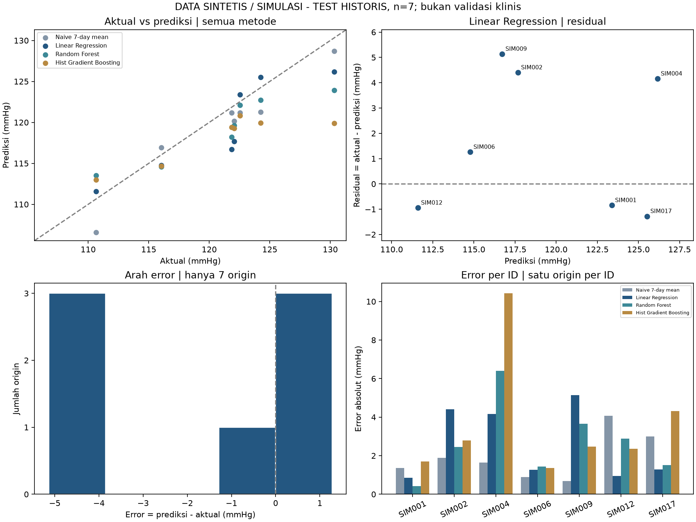

# Evaluasi dan analisis error Minggu 10

DATA SINTETIS / SIMULASI. Run sumber `e34327cd28c78f592900`.

## Apa yang dikerjakan
Evaluasi ini membaca metrik/manifest tuning terverifikasi dan prediksi tersimpan.
Tidak melakukan training, tuning, pemilihan ulang, akses database, atau promosi model.
Target/fitur/split tetap milik eksperimen tuning. Persetujuan target diasumsikan untuk
tugas ini; hasilnya tidak menjadi bukti persetujuan akademik atau hasil data aktual.

## Verifikasi sumber dan perhitungan
- Hash manifest/model tuning diverifikasi dengan `load_tuning`.
- Hash dua CSV dan fingerprint prepared harus sama dengan provenance.
- ID-origin dan nilai target CSV dicocokkan dengan split dari sumber; duplikat,
  baris hilang/tambahan, NaN/inf dan target berbeda ditolak.
- Metrik dihitung ulang dari pasangan prediksi-aktual, dicocokkan dengan artefak
  terverifikasi. Validasi OOF dihitung ulang untuk naif dan konfigurasi terpilih tiap
  algoritma. OOF konfigurasi original tidak disimpan oleh langkah tuning, sehingga
  statistik error tambahan original pada validasi tidak dibuat-buat.
- **Signed error/bias = prediksi - aktual**: positif terlalu tinggi, negatif terlalu
  rendah. **Residual = aktual - prediksi**, tandanya berlawanan. Toleransi 1e-9 hanya
  untuk kesamaan numerik, bukan batas aman/validitas klinis.
- MAE/RMSE/bias/error absolut dalam mmHg; R2 tanpa satuan, bukan akurasi persen.

## Perbandingan test historis
Tabel validasi dan statistik tambahan tersedia pada `metrics_and_bias.csv`.

| Model | Tahap | MAE | RMSE | R2 | Bias | Terlalu rendah | Terlalu tinggi |
|---|---|---|---|---|---|---|---|
| Naive 7-day mean | reference | 1.934 | 2.235 | 0.850 | -1.679 | 6 | 1 |
| Linear Regression | original | 2.575 | 3.114 | 0.709 | -1.697 | 4 | 3 |
| Linear Regression | selected_configuration | 2.575 | 3.114 | 0.709 | -1.697 | 4 | 3 |
| Random Forest | original | 2.959 | 3.441 | 0.645 | -2.208 | 5 | 2 |
| Random Forest | selected_configuration | 2.682 | 3.236 | 0.686 | -1.860 | 6 | 1 |
| Hist Gradient Boosting | original | 3.693 | 4.832 | 0.300 | -3.061 | 6 | 1 |
| Hist Gradient Boosting | selected_configuration | 3.631 | 4.651 | 0.352 | -2.955 | 6 | 1 |

## Interpretasi yang didukung hasil
RF dan HGB membaik setelah tuning dibanding pengaturan awal pada validasi dan test
historis. Linear Regression tetap model terlatih yang dipilih **dari validasi**;
baseline naif tetap mengungguli model terlatih secara agregat pada eksperimen ini.
Tidak menggunakan hasil test untuk memilih pemenang baru atau mengubah grid.

Perbaikan agregat tidak berarti setiap prediksi membaik. Pada RF, error absolut
terbesar naik dari 6.017 menjadi
6.406 mmHg, meskipun RMSE turun.
Pada Linear Regression, error absolut lebih kecil dari naif pada
3 pasangan dan lebih besar pada
4 pasangan. Ini perbandingan deskriptif, bukan
uji signifikansi atau alasan untuk memilih model berdasarkan test.

Untuk Linear Regression, bias historis -1.697 mmHg;
4 dari 7 prediksi terlalu rendah dan
3 terlalu tinggi. Arah ini hanya merangkum tujuh origin,
bukan bukti bias populasi yang konsisten. MAE 2.575 mmHg menunjukkan
rata-rata besar error, sedangkan RMSE 3.114 lebih sensitif pada error besar.

## Lima error terbesar model terpilih
Setiap target merupakan rerata SBP tujuh hari setelah origin (rentang pada sampel ini
2026-09-19 sampai 2026-09-25), bukan satu pembacaan tekanan darah. Kolom arah `under` berarti
terlalu rendah dan `over` berarti terlalu tinggi. Semua angka dihitung sebelum pembulatan.

| ID | Origin | Aktual | Prediksi | Error absolut | Error naif | Arah |
|---|---|---|---|---|---|---|
| SIM009 | 2026-09-18 | 121.857 | 116.721 | 5.136 | 0.679 | under |
| SIM002 | 2026-09-18 | 122.071 | 117.669 | 4.402 | 1.893 | under |
| SIM004 | 2026-09-18 | 130.321 | 126.164 | 4.157 | 1.643 | under |
| SIM017 | 2026-09-18 | 124.250 | 125.529 | 1.279 | 3.000 | over |
| SIM006 | 2026-09-18 | 116.036 | 114.776 | 1.259 | 0.893 | under |

Error terbesar terjadi pada SIM009: 5.136 mmHg.
Pada contoh yang sama, baseline naif memperkirakan 121.179 mmHg
dengan error 0.679 mmHg. Jadi penyesuaian model terlatih
tidak selalu memperbaiki pembanding sederhana pada setiap contoh.
Ini temuan deskriptif, bukan bukti profil, obat atau gaya hidup tertentu menyebabkan
kesalahan. Tidak mengklaim penyebab error tanpa eksperimen/analisis tambahan.

## Error per responden dan grafik
`errors_per_respondent.csv` memuat statistik per metode dan ID; hanya **satu origin
per ID** sehingga MAE per ID sama dengan error absolut satu contoh dan R2 tidak
tersedia. Jangan meranking kestabilan individu atau membuat kesimpulan demografi.



Grafik: (1) aktual vs prediksi empat metode, (2) residual model terpilih,
(3) histogram signed error dengan sampel tujuh, (4) error absolut per ID.
Histogram tidak digunakan untuk mengklaim normalitas. Tidak ada interval keyakinan
atau klaim signifikansi statistik dari sampel ini.

## Keterbatasan dan keputusan
DATA SINTETIS / SIMULASI. Inner GroupKFold memisahkan ID, tetapi kalender fit/validasi dapat beririsan dan target window training berkorelasi. Ini bukan validasi forecasting kronologis penuh. Test CP3 sudah pernah diperiksa; evaluasi ulang bersifat historis, bukan holdout baru. Sampel kecil; bukan validasi klinis atau hasil data aktual. Persetujuan target diasumsikan untuk tugas ini; bukti akademik belum direkam dalam artefak aktif.

Hasil validasi OOF dipakai saat memilih/tuning, sehingga bukan evaluasi eksternal
yang independen. Kalender inner CV beririsan; window training berkorelasi.
Semua origin test historis berada pada tanggal yang sama, sehingga belum menilai
perubahan performa antarperiode. Bukti di sini tidak menentukan penyebab naif unggul.
Tabel error memiliki 49 baris (tujuh metode/konfigurasi pada tujuh origin), bukan
49 contoh independen.

Keputusan teknis: pertahankan hasil tuning sebagai eksperimen terpisah. Jangan
menyebut model lebih akurat pada responden aktual. Langkah penelitian berikutnya
memerlukan dataset aktual tervalidasi dan kalender lebih panjang untuk evaluasi
waktu/prospektif; model serving aktif tidak diganti dalam pekerjaan ini.

## Reproduksi dan file hasil
Jalankan dari root dengan environment proyek:

```powershell
.\.venv\Scripts\python.exe -m etl.evaluate_week10_models
```

Notebook: `notebooks/06_evaluasi_error_minggu10.ipynb`.
Kode: `backend/app/model_evaluation.py`, `etl/evaluate_week10_models.py`.
Tabel/JSON/gambar: `reports/week10_evaluation/`.
Model card diperbarui hanya di `models/tuning_week10/MODEL_CARD.md`.
Hasil pemeriksaan: `reports/week10_evaluation/verification.json`.
Tidak perlu menjalankan training ulang; skrip menolak prediksi/sumber yang tidak cocok.

## Pengujian
Perintah: `python -m pytest backend/tests/test_week10_evaluation.py backend/tests/test_week10_tuning.py backend/tests/test_p2_model_comparison.py -q -p no:cacheprovider --junitxml=reports/week10_evaluation/tests.xml`.
Ringkasan JUnit tersedia pada eksekusi laporan ini: `{"errors": 0, "failures": 0, "junit_sha256": "e0ad9d695529e70799f4ca8b4775235f3478ac9bcbd6c1e6a87a8820f22d3afa", "passed": 31, "skipped": 0, "tests": 31}`.
Tes memeriksa arah/besar error, penolakan NaN/inf dan target/ID tidak cocok,
rekomputasi metrik, tidak ada pemanggilan fit saat evaluasi, serta model card yang
idempoten dan menolak sumber stale. Notebook dieksekusi tanpa output error dan
grafik diperiksa secara visual. Frontend/browser dan PostgreSQL tidak diuji ulang
karena pekerjaan ini hanya evaluasi offline, tanpa perubahan pada jalur tersebut.
